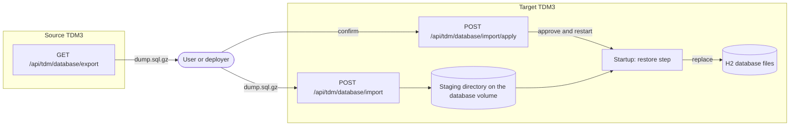
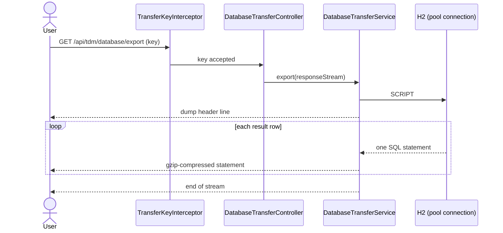
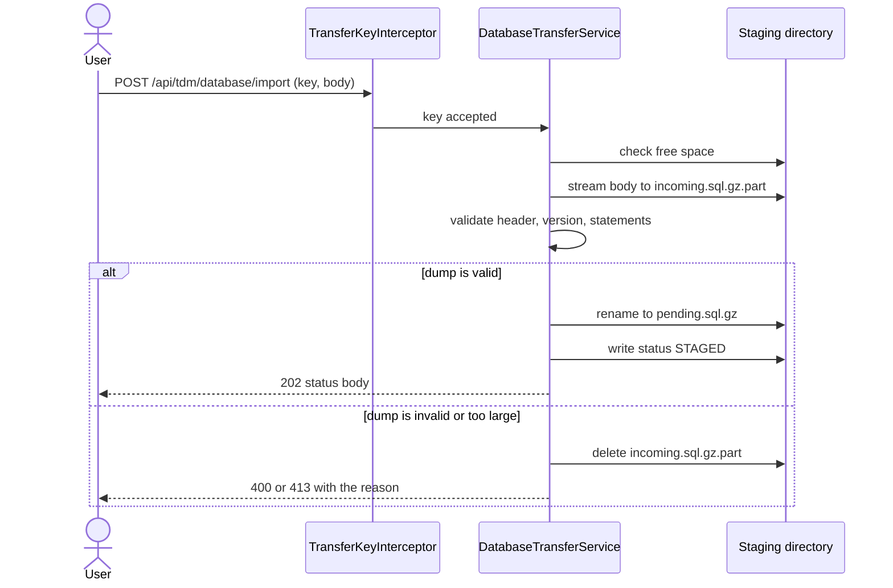
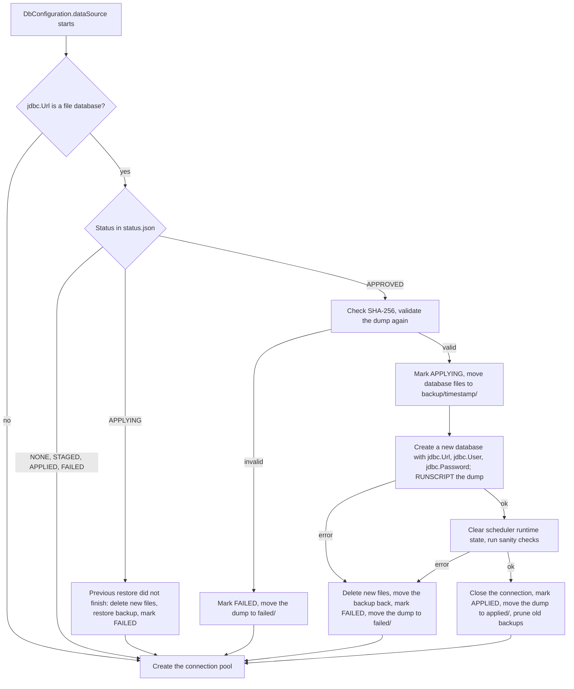
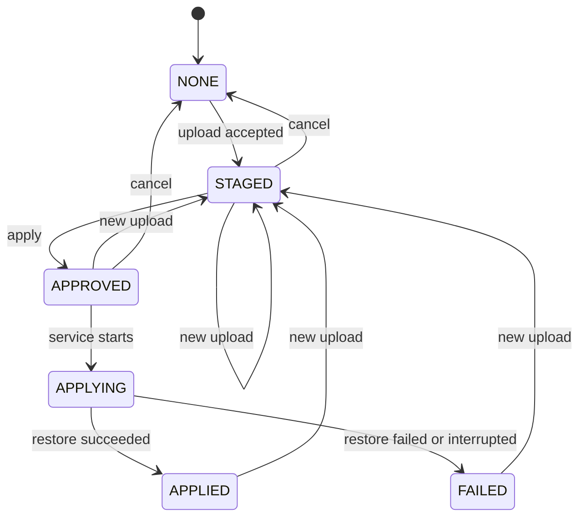

# Database transfer design

Status: proposal for discussion. This page elaborates
[ADR 0001](../adr/0001-database-transfer-through-rest-api.md), which records the decision. It describes the behavior the
feature will have, the components that implement it, and what the [spikes](#spikes) found.

## Goals and non-goals

The feature lets a project move the whole state of one TDM3 service to another TDM3 service through the REST API, with
no access to the file system of either service.

Goals:

- Export the whole database from a running service.
- Import a database into a service so that the service starts from the imported data.
- Keep the previous database restorable when an import fails.
- Keep the feature off until a deployer enables it, and keep it behind a secret afterwards.

Non-goals:

- Moving a part of the data. The existing per-table export and import cover that.
- Merging a dump into a database that already holds data. An import replaces the whole database.
- Access control for the rest of the service.
- Support for in-memory or remote databases. The service refuses the operations when `JDBC_URL` is not a file database.
- Downgrades. A dump from a newer version of the service is rejected.

## Overview

The user exports a dump from the source service and uploads it to the target service. The upload only stores the dump in
a staging directory. A second request approves the replacement and restarts the service. The replacement itself runs
during startup, before the service opens a connection pool.



The two-step import is deliberate. An upload destroys nothing, so a wrong file costs nothing. The replacement needs a
separate, explicit request. A restart that has nothing to do with the transfer, such as a rescheduled pod, never applies
a dump that nobody approved.

## Components

The class names are proposals. The packages follow the existing layout of the backend module.

| Component                                        | Package                   | Responsibility                                                                                               |
|--------------------------------------------------|---------------------------|--------------------------------------------------------------------------------------------------------------|
| `DatabaseTransferController`                     | `controllers`             | The five REST operations under `/api/tdm/database`.                                                          |
| `DatabaseTransferService` and its implementation | `service`, `service.impl` | Streams the export, stages and validates an upload, records the status, approves and cancels.                |
| `TransferKeyInterceptor`                         | `configuration`           | Checks the transfer key for every request under `/api/tdm/database/**`.                                      |
| `DumpValidator`                                  | `service.impl`            | Reads a dump once and rejects it if it is not a TDM3 dump or contains a forbidden statement.                 |
| `DatabaseRestoreInitializer`                     | `configuration`           | Replaces the database files at startup. Called from `DbConfiguration.dataSource` before the pool is created. |
| `TransferStatusStore`                            | `service.impl`            | Reads and writes `status.json` in the staging directory.                                                     |

`DbConfiguration.dataSource` creates a `HikariDataSource` with a minimum idle size of at least one connection, so the
pool opens the database file as soon as the bean exists. The restore step therefore runs first, inside that method,
before `new HikariDataSource(config)`. Quartz, ShedLock, and Liquibase all depend on this `DataSource` bean, so none of
them touches the database before the restore step finishes.

## Configuration

| Property                      | Environment variable       | Default                               | Meaning                                                                                                                                                |
|-------------------------------|----------------------------|---------------------------------------|--------------------------------------------------------------------------------------------------------------------------------------------------------|
| `tdm.db.transfer.key`         | `TDM_DB_TRANSFER_KEY`      | unset                                 | The transfer key. At least 32 characters. The feature is off while the key is unset or shorter.                                                        |
| `tdm.db.transfer.max-size`    | `TDM_DB_TRANSFER_MAX_SIZE` | `100MB`                               | Largest compressed dump the service accepts, as a Spring data size. `100MB` is 104857600 bytes. Independent of `MAX_FILE_SIZE` and `MAX_REQUEST_SIZE`. |
| `tdm.db.transfer.staging-dir` | `TDM_DB_TRANSFER_DIR`      | `transfer` next to the database files | Directory for the staged dump, the status file, and the backups. It must be on the same volume as the database.                                        |
| `tdm.db.transfer.backups`     | `TDM_DB_TRANSFER_BACKUPS`  | `2`                                   | Number of database backups to keep after a successful import.                                                                                          |

The Helm chart in `deployments/charts/atp3-tdm-be` passes `TDM_DB_TRANSFER_KEY` from a Kubernetes Secret and can
generate the key at deployment. See [Deploying the key with Helm](#deploying-the-key-with-helm).

### Deploying the key with Helm

The chart takes the key from one of three sources, in this order. Every source is off until
`atp3tdm.dbTransfer.enabled` is `true`. While it is `false`, the chart renders no Secret and no
`TDM_DB_TRANSFER_KEY` variable, and the transfer endpoints answer `404`.

| Value                               | Meaning                                                                                                                                                   |
|-------------------------------------|-----------------------------------------------------------------------------------------------------------------------------------------------------------|
| `atp3tdm.dbTransfer.enabled`        | `false` by default. Turns the feature on for the deployment.                                                                                              |
| `atp3tdm.dbTransfer.existingSecret` | Name of a Secret that the deployer manages. It must hold the key under the entry `TDM_DB_TRANSFER_KEY`. The chart creates nothing and only references it. |
| `atp3tdm.dbTransfer.key`            | A key the deployer supplies. The chart stores it in its own Secret.                                                                                       |
| (both empty)                        | The chart generates a key of 48 random alphanumeric characters (`randAlphaNum 48`) and stores it in its own Secret.                                       |

The chart-owned Secret is named `<SERVICE_NAME>-db-transfer` and has one entry, `TDM_DB_TRANSFER_KEY`. The Deployment
reads it with a `secretKeyRef`, like the other secret variables, so the key never appears in the pod specification.

Generating the key at every render would change it at every upgrade, and a key that changes under a running client is
useless. The template therefore calls `lookup` for the Secret first and reuses its value when the Secret exists. The
Secret is an ordinary resource and not a hook, unlike `<SERVICE_NAME>-secrets`, whose `before-hook-creation` policy
deletes it before each upgrade. It carries `helm.sh/resource-policy: keep`, so `helm uninstall` leaves it in place, and
a reinstall then finds the old key.

The deployer reads the generated key from the cluster. The chart never prints it, because Helm output ends up in CI
logs:

```bash
kubectl get secret <SERVICE_NAME>-db-transfer -n <namespace> -o jsonpath='{.data.TDM_DB_TRANSFER_KEY}' | base64 -d
```

To rotate a generated key, delete the Secret, upgrade the release, and restart the pod. To rotate through the chart
alone, set `atp3tdm.dbTransfer.key` or `existingSecret` instead.

Limits of this approach:

- `lookup` returns nothing under `helm template` and `helm install --dry-run`, and in tools that render the chart
  without cluster access, such as Argo CD. A render without cluster access generates a different key every time. A
  deployment that renders this way must set `key` or `existingSecret`. The chart cannot detect this case.
- The key in the Secret is not read again while the pod runs. After a change of the key, the pod has to restart. The
  Deployment already uses the `Recreate` strategy, and the chart adds a `checksum/db-transfer` annotation to the pod
  template, computed from the key a deployer supplies, so that an upgrade with a new `key` restarts the pod. A generated
  key does not change during an upgrade, so it needs no annotation. A rotated generated key and a change inside an
  `existingSecret` need a manual restart.
- The `COMPOSE` platform renders environment lines and has no Secret and no `lookup`. There the deployer sets
  `atp3tdm.dbTransfer.key`, and the chart does not generate one.
- A generated key is as private as the namespace. Anyone who can read Secrets in the namespace can read it, which
  matches the trust that [the key already carries](#the-dump-is-executable-sql).

## Access: the transfer key

The service has no user model and runs with the `disable-security` profile, so the transfer endpoints cannot reuse a
role check. They use a shared secret instead.

- A `HandlerInterceptor` registered for `/api/tdm/database/**` checks the key. It works the same way in every Spring
  profile, so it does not depend on the security stack.
- While the key is unset or shorter than 32 characters, every transfer endpoint answers `404`. At startup the service
  logs one warning that says why the feature is off, without printing the key.
- With a key configured, a request must carry it in the `X-TDM-Transfer-Key` header. A missing or wrong key gets `403`
  with the same body in both cases.
- The comparison runs in constant time (`MessageDigest.isEqual` on the digests of both values).
- The key protects the transfer endpoints only. It does not change who can call the rest of the API.

The request logging of the service writes request headers to the log by default (`atp.logging.controller.headers`). The
feature adds `X-TDM-Transfer-Key` to the default of `atp.logging.controller.headers.ignore`, so the key never reaches
the log. A deployer who overrides that property has to keep the entry.

The key goes in a header, so the service must be reached over TLS. Terminating TLS at the ingress is enough.

### The dump is executable SQL

`RUNSCRIPT` runs every statement in the dump with the privileges of the service's database user. H2 can compile Java
source in `CREATE ALIAS` and in triggers, read files with `FILE_READ`, and load files with `CSVREAD`. A crafted dump is
therefore a way to run code inside the service JVM, which can read the environment, including `ATP_CRYPTO_KEY` and the
database credentials.

The transfer key already allows a holder to read and replace all data, so the key holder is trusted at administrator
level. The risk is bigger than data replacement, though, so the import adds a second barrier. `DumpValidator` reads the
whole dump once while it is stored, splitting it into statements with a tokenizer that understands quoted strings,
quoted identifiers, and comments. It accepts only the statement kinds that a dump of the live database contains
([spike S4](#spikes)):

- `CREATE CACHED TABLE`, `ALTER TABLE ... ADD CONSTRAINT`, and `CREATE INDEX`;
- `INSERT INTO ... VALUES`;
- comment lines (`-- ...`), including the `-- H2 <version>;` line and the row-count lines that `SCRIPT` writes;
- exactly one alias: `CREATE FORCE ALIAS "PUBLIC"."UUID_GENERATE_V4" FOR 'org.h2.value.ValueUuid.getNewRandom'`,
  which a Liquibase changeset creates in every TDM3 database. Any other alias, or this alias with another target, is
  rejected.

It rejects the dump when:

- a statement is of any other kind, including `TRIGGER`, `AGGREGATE`, `RUNSCRIPT`, `CALL`, `SCRIPT`, `CSVREAD`,
  `CSVWRITE`, `FILE_READ`, `FILE_WRITE`, `LINK_SCHEMA`, `SHUTDOWN`, and `INSERT ... SELECT`;
- the first line is not the TDM3 dump header (see [Dump format](#dump-format-and-compatibility)).

The filter lowers the risk and does not remove it, because H2 is a large SQL dialect. A migration that adds a statement
kind to the schema adds it to the allowlist in the same change, and a test that dumps a freshly migrated database fails
until it does.

The service also stores the SHA-256 of the validated file in the status file and checks it again at startup before it
runs the dump.

### Users and passwords

A dump of the live database contains a `CREATE USER` statement for the database user of the service, with its password
hash ([spike S2](#spikes)). The export therefore runs `SCRIPT NOPASSWORDS`, so the hash never leaves the source. That
option alone makes the dump unsafe to load: it writes `CREATE USER IF NOT EXISTS "<name>" PASSWORD '' ADMIN`, and a
database that runs the statement accepts a login of that administrator with an empty password.

The staging step therefore drops every statement that creates or changes a user or a role, or grants a right, and stores
the dump without them. This is the one case where the validator removes a statement instead of rejecting the dump,
because every dump the export writes contains one. The database user and password of the target stay those of
`TDM_DB_USER` and `TDM_DB_PASSWORD`. The SHA-256 in the status file is the hash of the stored file.

## REST API

All paths are relative to the service root, as in [docs/api.md](../api.md#base-path-and-the-atp-gateway). Every
operation needs the `X-TDM-Transfer-Key` header.

| Operation           | Method and path                                                             | Success                   | Errors                                                                                                                                   |
|---------------------|-----------------------------------------------------------------------------|---------------------------|------------------------------------------------------------------------------------------------------------------------------------------|
| Export              | `GET /api/tdm/database/export`                                              | `200`, `application/gzip` | `404` feature off, `403` wrong key, `409` not a file database or an export already running                                               |
| Stage a dump        | `POST /api/tdm/database/import`                                             | `202`, status body        | `400` invalid dump with the reason, `403`, `404`, `409` not a file database, `413` over the size limit, `507` not enough free disk space |
| Read the status     | `GET /api/tdm/database/import`                                              | `200`, status body        | `403`, `404`                                                                                                                             |
| Cancel              | `DELETE /api/tdm/database/import`                                           | `204`                     | `403`, `404`                                                                                                                             |
| Approve and restart | `POST /api/tdm/database/import/apply?confirm=REPLACE_ALL_DATA&restart=true` | `202`, status body        | `400` missing or wrong `confirm`, `403`, `404`, `409` nothing is staged                                                                  |

Details:

- **Export.** The response has `Content-Disposition: attachment; filename="tdm-<database>-<timestamp>.sql.gz"`.
  The body is streamed, so the response has no `Content-Length`.
- **Stage a dump.** The request body is the raw `.sql.gz` file with `Content-Type: application/gzip`, not a multipart
  form. This avoids the global `spring.servlet.multipart` limit (`MAX_FILE_SIZE`, 100 MB by default), which also applies
  to the table import. A new upload replaces a staged or approved dump and sets the state back to `STAGED`.
- **Approve and restart.** `confirm` must be exactly `REPLACE_ALL_DATA`. With `restart=true` (the default) the service
  exits cleanly after the response is sent and relies on the platform to start it again. With `restart=false` the
  dump is approved and waits for the next restart, which the deployer triggers.
- **Cancel.** Deletes the staged dump and sets the state to `NONE`. It is also the way to withdraw an approved dump
  before the restart.

The status body:

```json
{
  "state": "STAGED",
  "uploadedAt": "2026-11-11T10:15:30Z",
  "sizeBytes": 73400320,
  "sha256": "9f2c...e1",
  "dumpServiceVersion": "1.0.13",
  "dumpH2Version": "2.2.224",
  "warnings": [],
  "approvedAt": null,
  "finishedAt": null,
  "error": null
}
```

`warnings` lists problems that do not stop the import, such as a large version gap (see
[Dump format](#dump-format-and-compatibility)). The upload response and every later status response carry it.

The states are `NONE`, `STAGED`, `APPROVED`, `APPLYING`, `APPLIED`, and `FAILED`. After a restore, `GET` shows the last
result (`APPLIED` or `FAILED` with `error`) until the next upload.

The controller uses the same `@Operation` and `@AuditAction` annotations as its siblings, so the operations appear in
Swagger UI and in the audit log. The frozen specifications in `qubership-atp-tdm-rest-openapi-specifications` are not
touched.

## Export

The export runs the H2 `SCRIPT NOPASSWORDS` command on one connection from the pool and writes each returned row
straight into the response through a `GZIPOutputStream`. It uses `StreamingResponseBody`, so neither the dump nor a
temporary file sits in memory or on disk.

The export runs in one transaction: `autoCommit` is off and the isolation level is `REPEATABLE_READ`. With H2's default
`READ_COMMITTED`, `SCRIPT` reads each table at its own point in time, so a dump taken under write load can hold a
transaction in one table and not in another ([spike S1](#spikes)). In the repeatable-read transaction, every table
shows the same snapshot, and writers are not blocked.



Only one export runs at a time. A second request gets `409`. The export holds one pooled connection for its whole
duration. The default pool has four connections (`jdbc.MaxPoolSize`), so the limit of one export keeps it from starving
the service.

The first line of the dump is a comment that the service writes before the `SCRIPT` rows:

```text
-- TDM3-DUMP v1 service=1.0.13 h2=2.2.224 created=2026-11-11T10:15:30Z database=atptdm
```

## Import: staging

The upload streams into `transfer/incoming.sql.gz.part`. The same pass counts bytes against the size limit, decompresses
the stream, and feeds it to `DumpValidator`, so a large file is read once. Only a file that passes becomes
`transfer/pending.sql.gz` by an atomic rename, and only then does the status become `STAGED`.



The free-space check requires room for the upload and the restored database next to the current one, which the restore
moves to `backup/` instead of copying it. It estimates the restored size as five times the size of the dump, which is
above the 4.2 to 4.6 that [spike S6](#spikes) measured.

The version rule at this step compares the service version in the dump header with the version of the running service.
See [Dump format](#dump-format-and-compatibility) for the outcomes.

## Import: applying at startup

`DatabaseRestoreInitializer` runs when the `DataSource` bean is created. It only acts when the status is `APPROVED`, or
`APPLYING` after a crash.



Rules that the diagram does not show:

- A failed restore does not stop the service. The service starts with the previous data, and `GET
  /api/tdm/database/import` reports `FAILED` with the reason. An import is a request, and a failed request does not take
  the service down.
- A crash during the restore rolls back. A dump that crashes the JVM (out of memory, for example) would otherwise
  loop on every restart.
- The database file path comes from `jdbc.Url`: `jdbc:h2:file:./database/atptdm;MODE=PostgreSQL` means
  `./database/atptdm.mv.db`. The new database is opened with the configured `jdbc.Url`, so settings in the URL, such as
  `MODE=PostgreSQL`, apply to it and do not come from the dump.
- The sanity checks read the Liquibase changelog table and the TDM3 catalog table and require that both exist. They do
  not run Liquibase.

### Scheduler state

The dump includes the Quartz and ShedLock tables. They hold two kinds of rows.

**Definitions** say what runs and when: `QRTZ_JOB_DETAILS`, `QRTZ_TRIGGERS` with the cron, simple, and blob trigger
tables, `QRTZ_CALENDARS`, and `QRTZ_PAUSED_TRIGGER_GRPS`. They are project data, such as the cleanup, refresh, and
statistics schedules. The restore keeps them unchanged, so the target runs the same schedules as the source.

**Runtime state** says what the source process was doing when the dump was taken:

- `QRTZ_SCHEDULER_STATE` holds the source's scheduler instance (`instanceId` is `AUTO`, so every start gets a new one).
- `QRTZ_FIRED_TRIGGERS` holds the executions that were in progress.
- `QRTZ_TRIGGERS.TRIGGER_STATE` is `ACQUIRED`, `BLOCKED`, or `PAUSED_BLOCKED` for triggers that an instance had claimed.
- Every row of the `shedlock` table is a lock held by the source, valid until its `lock_until` time.

The target must not inherit this state, because it belongs to a process that the target does not have. No scheduler runs
during the restore step, so the rows do no harm there. They take effect after the target starts. A trigger that the
source had claimed could stay claimed, a stale instance row would send Quartz looking for a scheduler that does not
exist, and a bulk action could wait for a lock that expires up to `LOCK_BULK_ACTION_SEC` (3600 seconds by default)
later. Job recovery is not among the effects: every TDM3 job has `requests_recovery` set to false, so Quartz never
reruns a job that was in progress.

After `RUNSCRIPT`, and before the sanity checks, the restore step clears the runtime state in one transaction:

1. Delete all rows of `QRTZ_FIRED_TRIGGERS` and `QRTZ_SCHEDULER_STATE`.
2. Set `TRIGGER_STATE` to `WAITING` where it is `ACQUIRED` or `BLOCKED`, and to `PAUSED` where it is `PAUSED_BLOCKED`.
   These are the changes Quartz makes itself when it recovers the jobs of a scheduler.
3. Delete all rows of `shedlock`.

The rows of `QRTZ_LOCKS` stay: they are fixed rows that the Quartz job store needs. A trigger in the `ERROR` state stays
in it, as on the source. A failure in the cleanup fails the restore, and the rollback applies. A trigger whose fire
time has passed is handled by Quartz misfire handling when the service starts, as after any downtime. This has a
visible effect on the data: see [Table expiry and transferred data](#table-expiry-and-transferred-data).

The cleanup runs on the import side, not on the export side. The target is where the rule has to hold for every dump,
and removing the rows from the export stream would not reset `TRIGGER_STATE`. The dump stays a complete copy of the
source database. [Spike S5](#spikes) confirms the statements against the Quartz version in use.

## State machine



## Files on the volume

```text
database/
  atptdm.mv.db                      the live database
  transfer/
    status.json                     state, hashes, versions, last error
    incoming.sql.gz.part            an upload in progress
    pending.sql.gz                  the staged or approved dump
    backup/<yyyyMMdd-HHmmss>/       database files replaced by an import
    applied/<yyyyMMdd-HHmmss>.sql.gz
    failed/<yyyyMMdd-HHmmss>.sql.gz
```

`applied/` and `failed/` hold the dump of the last restore only, to keep disk use bounded. The
`tdm.db.transfer.backups` property limits `backup/`.

## Failure handling

| Failure                                                            | What happens                                                                                                                                                                                  |
|--------------------------------------------------------------------|-----------------------------------------------------------------------------------------------------------------------------------------------------------------------------------------------|
| Upload interrupted                                                 | `incoming.sql.gz.part` is deleted on the next upload or at startup. The previous staged dump stays.                                                                                           |
| Dump fails validation                                              | `400` with the reason. Nothing is staged.                                                                                                                                                     |
| Disk full during upload                                            | `507` where the pre-check catches it. Otherwise the part file is deleted and the request fails.                                                                                               |
| Wrong or missing key                                               | `403`. The attempt is logged with the client address and no value of the key.                                                                                                                 |
| Restore fails                                                      | Rollback to the backup, status `FAILED`, service starts with the old data.                                                                                                                    |
| Process dies during the restore                                    | Next start rolls back (`APPLYING` found), status `FAILED: interrupted`.                                                                                                                       |
| Liquibase or a later startup step fails after a successful restore | The service does not start, as it does not start for any broken database. The API is not available, so the [recovery runbook](#recovery-when-the-service-does-not-start) works on the volume. |
| Platform does not restart the service after `apply`                | The dump stays `APPROVED` until someone restarts the service. `GET` shows it.                                                                                                                 |

## Dump format and compatibility

- The file is a gzip stream of UTF-8 SQL statements, one `SCRIPT` row per statement, preceded by the header line.
- The header carries the version of the service that wrote the dump (its `project.version`). A qualifier such as
  `-SNAPSHOT` is ignored when the versions are compared. The upload compares it with the version of the running
  service:

  | Dump version                       | Outcome                                                                                  |
  |------------------------------------|------------------------------------------------------------------------------------------|
  | Newer than the service             | Rejected with `400`. Downgrades are not supported.                                       |
  | Same major version, equal or older | Accepted. Liquibase brings the schema forward on the next start.                         |
  | Older major version                | Accepted with an entry in `warnings`, for example a dump from 1.0.5 loaded into 5.10.20. |
  | Missing or not a version           | Rejected with `400`.                                                                     |

  The warning is information, not a block: the approval is a separate request, and the person who sends it sees the
  warning in the status. A version gap inside one major version, such as 1.0.5 into 1.5.10, gives no warning.
- **The version `0.0.1.LOCAL`.** This is the placeholder of a development run, not a release, and a service on a project
  machine never has it. Two rules cover it, and the rest of the table does not apply to it:
  - A target with the version `0.0.1.LOCAL` counts as newer than every dump whose version is not `0.0.1.LOCAL`. The
    import is not blocked. The status carries a `warnings` entry that names both versions, for example `The dump comes
    from 1.0.13 and this service runs 0.0.1.LOCAL, a development version that counts as newer than any release`.
  - A dump with the version `0.0.1.LOCAL` comes from a development run. Into a target with the same version it is
    accepted. Into a target with another version the service applies no special rule, and the developer decides what
    that import means for the change being tested.
- The H2 version of the dump is recorded for diagnostics. Loading a dump from another H2 major version is not
  guaranteed. [Spike S3](#spikes) tests the versions the project uses.

## Operations

- **Disk.** During a restore the volume holds the replaced database, the restored database, and the staged dump. The
  restored database was never larger than half the size of the source file in the spikes, because the restore writes a
  compact file, so twice the database plus the dump is enough for the restore. Add the backups that stay afterwards
  (`tdm.db.transfer.backups`, each as large as the database it replaced).
- **Ingress.** The upload and the export are large and long. The ingress or gateway must allow a request body as large
  as the biggest dump (for NGINX, `proxy-body-size`) and a read timeout longer than the longest export.
- **Restart.** `apply` with `restart=true` exits with status 0. A Kubernetes Deployment restarts the container. A plain
  `docker run` without a restart policy does not, so the deployer restarts it.
- **Memory.** The upload and the export stream, so memory use does not grow with the size of the database.
- **The source service.** The target runs the same schedules as the source: cleanup, refresh, and the statistics emails.
  If the source keeps running after the export, both services run them. Stop or disable the source when the move is
  final.

## Table expiry and transferred data

TDM3 deletes a test data table when its last use is older than the retention period. The rows of such a table are
references to data in the database of the system under test, and a month later that system has replaced the data, so
the table has lost its value. The cleanup is part of how the service works, and a transfer neither disables it nor
changes the last-use time of a table.

The cleanup compares the last use of each table in `TEST_DATA_TABLE_CATALOG` with the retention period.
`DEFAULT_TABLE_EXPIRATION_MONTHS` sets it (`default.table.expiration.months`, one month by default), and the settings of
a project in `PROJECT_INFORMATION` override it. `TABLE_EXPIRATION_CRON` sets when the job runs (`table.expiration.cron`,
every day at midnight by default). A job that missed its time runs when the service starts. In the spike, a restored
database whose cleanup trigger was 19 days overdue lost 8 of its 11 tables during the first start, together with their
import information and cleanup configurations, and 8 entries were added to `DELETED_TABLES_HISTORY`
([spike S5](#spikes)).

The people who use the transfer have to expect this. These cases need to be in the user documentation:

1. **Export from a service with a short retention period.** The source has already deleted every table older than its
   period, so the dump holds only what is left, and that can be little.
2. **Import of a dump that was exported long ago.** A table last used more than the retention period before the import
   is deleted on the first start after the restore, or at the next midnight at the latest. A dump that has been stored
   for weeks may therefore bring back few tables or none.
3. **Import into a service with different retention settings.** `PROJECT_INFORMATION` is part of the dump, so the
   per-project timeouts of the source replace those of the target. The default period comes from the environment of the
   target and is not part of the dump.
4. **A staged dump that waits for approval.** Staging and approval do not change the last use of a table, so the time a
   dump waits counts against its tables.
5. **Rollback from `backup/`.** The database in a backup is old by the time of the rollback, so the first start after
   it deletes the tables that expired in between.

## Recovery when the service does not start

After a successful replacement, startup continues as an ordinary start, and Liquibase runs as it always does. If
Liquibase or another step fails, the service does not start and the REST API, including the status endpoint, is not
available. The recovery therefore works on the volume. The implementation turns these steps into a page in
`docs/troubleshooting.md` for administrators and the support team:

1. Stop the service.
2. In the staging directory, find the newest directory under `backup/`. It holds the database files that the import
   replaced. The service logs its path at `INFO` level when the replacement finishes.
3. Move the current database files out of the database directory, and keep them for the analysis of the failure.
4. Copy the files from the backup directory into the database directory.
5. Start the service. It starts with the previous data. `status.json` still says `APPLIED`, which does no harm: only an
   `APPROVED` dump is applied.
6. Keep the dump in `applied/` for the analysis. A new upload replaces it.

## Tests

- Round trip: export a database with several test data tables, import the dump into an empty service, compare the
  catalog and the table contents.
- Older dump: import a dump from the previous schema version and check that Liquibase upgrades it.
- Version rule: a dump from a newer version and a dump with a missing version are rejected. A dump from an older major
  version is accepted with an entry in `warnings`. A dump from an older minor version of the same major version is
  accepted with no warning.
- Scheduler state: export while a cleanup job runs and a bulk action holds a lock, import the dump, and check that the
  target keeps the schedules, holds no scheduler instance, fired trigger, claimed trigger state, or lock of the source,
  and fires the jobs on schedule. See [Scheduler state](#scheduler-state).
- Rollback: stage a dump that fails in the middle of `RUNSCRIPT`, restart, and check that the old data is back and the
  status is `FAILED`.
- Crash: kill the process between moving the backup and finishing the restore, restart, and check the rollback.
- Validator: dumps that contain a `CREATE ALIAS` other than `UUID_GENERATE_V4`, a trigger, `FILE_READ`, a nested
  `RUNSCRIPT`, and `INSERT ... SELECT` are rejected. A real dump of a large database is accepted. A dump of a freshly
  migrated database is accepted, so a new migration cannot break the allowlist unnoticed.
- Users: a dump with a `CREATE USER ... ADMIN` statement is accepted, the stored file has no user statements, and after
  the import only the user from `TDM_DB_USER` can log in, with its own password and not with an empty one.
- Consistency: export while several sessions write to two tables in one transaction, and check that both tables hold
  the same rows in the dump.
- Version: a dump from `1.0.13-SNAPSHOT` is parsed. A target on `0.0.1.LOCAL` accepts a dump from `1.0.13` with a
  warning that names both versions, and a dump from `0.0.1.LOCAL` with no warning.
- Key: no key, short key, wrong key, and right key, for each of the five operations, and the `404` while the feature is
  off. The key never appears in the log.
- Chart: `helm template` with the feature off renders no Secret and no variable. With it on and no key, a render
  against a cluster generates a 48-character key, and a second upgrade keeps it. With `key` or `existingSecret` set,
  nothing is generated, and the Deployment references the right Secret.
- Unapproved dump: restart with a `STAGED` dump and check that nothing changes.
- Size: an upload over the limit gets `413`, and the part file is removed.

## Documentation impact

Documentation that the implementation updates:

- `docs/api.md`: a row in the endpoint groups table for the new tag, and a section for the five operations.
- `docs/configuration.md`: the four properties above, in a new section.
- `docs/troubleshooting.md`: the errors of the transfer, including a restore that ended in `FAILED`, and the
  [recovery runbook](#recovery-when-the-service-does-not-start).
- `docs/architecture.md`: a short section that points to this page.
- A user-facing page about the transfer that lists the cases of [Table expiry and transferred
  data](#table-expiry-and-transferred-data), so that a deleted table after an import is no surprise.
- `CHANGELOG.md`: an entry under the next version.
- `deployments/charts/atp3-tdm-be`: the `atp3tdm.dbTransfer` values, the key Secret with its generated key, the
  `TDM_DB_TRANSFER_KEY` variable, the `checksum/db-transfer` annotation, and the default of
  `atp.logging.controller.headers.ignore`. The chart documentation lists the three key sources and the command that
  reads a generated key.

## Spikes

The spikes ran against H2 2.2.224, the version in `parent/qubership-atp-tdm-parent-java/pom.xml`. They used a copy of a
local development database, a copy of the database of a local 1.0.13 distribution (42 tables, 11 test data tables, no
leftover tables), and synthetic tables. S5 started the real service on a restored copy of the second database. The
scripts are not part of the repository.

| #   | Question                                                                                                           | Result                                                                                                                                                                                                                                                                                                                                                                                                                                                                                               |
|-----|--------------------------------------------------------------------------------------------------------------------|------------------------------------------------------------------------------------------------------------------------------------------------------------------------------------------------------------------------------------------------------------------------------------------------------------------------------------------------------------------------------------------------------------------------------------------------------------------------------------------------------|
| S1  | Does `SCRIPT` give a consistent snapshot while other sessions write, and does it block writers?                    | It does not block writers: with three writers, commits took 20 to 30 ms at most during an export, against 2 ms without it, and none failed. Under the default isolation level it is not consistent: two tables written in one transaction held 5033 and 5036 rows in the dump. In a transaction with `REPEATABLE_READ` or `SERIALIZABLE` and `autoCommit` off, both held the same rows in every run. See [Export](#export).                                                                          |
| S2  | Which `SCRIPT` options keep the user and password hash of the source out of the dump?                              | `NOPASSWORDS` replaces the hash with an empty password, and the user then logs in with an empty password and not with a wrong one. The dump has no `SET` rows, so `MODE=PostgreSQL` comes from the URL of the target. The staging step has to remove the user statement. See [Users and passwords](#users-and-passwords).                                                                                                                                                                            |
| S3  | Does a dump round trip for every column type, and does a dump from another H2 2.x version load?                    | After a round trip the 203 statements and every row count of the second database are equal. The types in use are VARCHAR, UUID, BOOLEAN, TIMESTAMP, BIGINT, INTEGER, DATE, VARBINARY, NUMERIC, SMALLINT, and one CLOB column. Dumps of 2.2.220 and 2.2.224 load into each other with the same content. Large LOB values were not tested.                                                                                                                                                             |
| S4  | Which statement kinds does a real dump contain?                                                                    | `ALTER TABLE`, `CREATE CACHED TABLE`, `CREATE INDEX`, `INSERT`, comments, one `CREATE USER`, and one alias, `UUID_GENERATE_V4`. No triggers, sequences, schemas, roles, or grants. See [The dump is executable SQL](#the-dump-is-executable-sql).                                                                                                                                                                                                                                                    |
| S5  | Does the service start, keep its schedules, and run them after the cleanup of [Scheduler state](#scheduler-state)? | Quartz 2.3.2 writes `ACQUIRED`, `BLOCKED`, and `PAUSED_BLOCKED` for claimed triggers, as assumed. `spring.quartz.jdbc.initialize-schema=ALWAYS` leaves existing rows intact. The service started on a restored copy in about 20 seconds with no errors, created a new scheduler instance, kept both jobs and triggers, and moved the next fire times to the future. The first start also ran the overdue table cleanup; see [Table expiry and transferred data](#table-expiry-and-transferred-data). |
| S6  | How large is the restored database compared with the gzip dump, and how long do the export and `RUNSCRIPT` take?   | Measured on synthetic data only. A 421 MB file gave a 43 MB dump, a 9.9 second export under write load, a 6.4 second restore, and a 196 MB restored file. The second database gave a 54 KB dump and a 225 KB restored file from 741 KB. The restored file is 4.2 to 4.6 times the dump. The multi-gigabyte case is still unmeasured.                                                                                                                                                                 |

## Decisions

1. **Restart.** `apply` with `restart=true` may make the service exit and rely on the platform to start it again. A
   manual stop and start after `apply` is also acceptable, because an import is a rare operation.
2. **Upload size.** The default of `tdm.db.transfer.max-size` is `100MB` for the compressed file, the same size as the
   defaults of `MAX_FILE_SIZE` and `MAX_REQUEST_SIZE`. The property is separate from them. A deployer who needs a
   larger dump raises it, and the ingress or gateway limits of the deployment apply as they do to every other upload.
3. **Scheduler state.** The import brings the definitions of the Quartz jobs and triggers over unchanged, like every
   other table. It clears the runtime state of the source: the scheduler instance, the fired triggers, the claimed
   trigger states, and the ShedLock rows. Definitions are project data, and runtime state belongs to the process that
   wrote it. See [Scheduler state](#scheduler-state).
4. **The key.** A shared secret is acceptable for now. The Helm chart can generate it at deployment when
   `atp3tdm.dbTransfer.enabled` is `true` and the deployer supplies no key. See
   [Deploying the key with Helm](#deploying-the-key-with-helm).
5. **Liquibase failure.** After the replacement, startup continues as an ordinary start, and Liquibase runs as it always
   does. If it fails, the service does not start. The administrators and the support team get the
   [recovery runbook](#recovery-when-the-service-does-not-start), which includes putting the previous database back.
6. **Version rule.** A dump from a newer version than the service is rejected. A dump from an older major version is
   accepted with a warning. See [Dump format](#dump-format-and-compatibility).

7. **Retention after an import.** The cleanup of expired tables is part of the service and applies to imported tables
   like any other. An import does not change the last use of a table. The user documentation lists the cases (see
   [Table expiry and transferred data](#table-expiry-and-transferred-data)).

8. **Development version.** A target on `0.0.1.LOCAL` counts as newer than any other version and accepts the import with
   a warning that names both versions. A dump from `0.0.1.LOCAL` is accepted by a target with the same version. See
   [Dump format](#dump-format-and-compatibility).

No open questions remain. The [spikes](#spikes) leave two measurements for the implementation: large LOB values (S3) and
a database of several gigabytes (S6).
